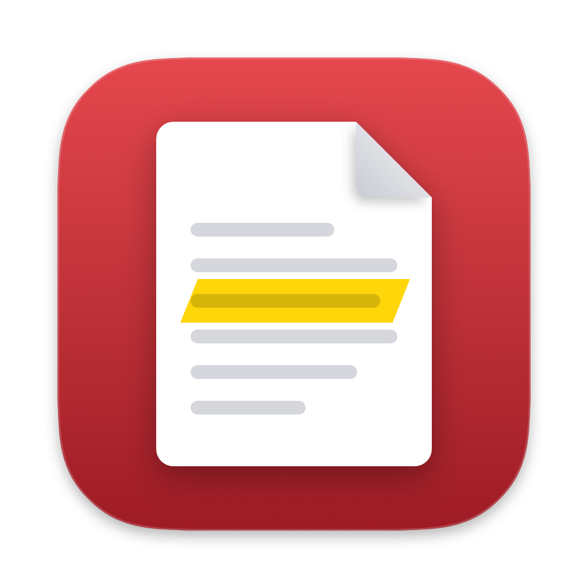
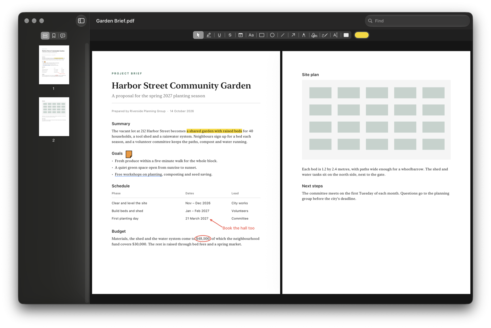

<p align="center">
  
</p>

<h1 align="center">Folio</h1>

<p align="center">
  A native PDF viewer and editor for the Mac, built on PDFKit, the engine behind Preview.<br>
  Free and open source. No account, no subscription.
</p>

<p align="center">
  <a href="https://github.com/Josephhamze/folio/releases/latest/download/Folio.dmg"></a>
  
  
  <a href="LICENSE"></a>
</p>



## Features

- **Home.** Folio opens on your recent files, shown as thumbnails. Click one to open it, or drop a PDF on the window. Each file reopens at the page you left it on.
- **Read.** The sidebar shows thumbnails, bookmarks and every comment. View one page, a continuous scroll or two pages side by side, zoom, and switch to a full-screen Read Mode. Type a page number in the toolbar to go to it. Find counts the matches and steps through them.
- **Mark up.** Highlight, underline, strike through, add notes and text boxes, and draw rectangles, ovals, lines, arrows and freehand ink, in any colour. Select a mark to move it, nudge it with the arrow keys, recolour it or delete it. Single keys pick the tools: V Select, H Highlight, T Text Box, S Sign. Each tool's tooltip shows its key.
- **Text that matches.** Click with the Text Box tool and type. The text takes the font, size and colour of the nearest text on the page. Beside a line, it sits on that line, so it looks typed into the document. Show Fonts (⌘T) changes a box's font and size.
- **Sign.** Draw or type your signature and initials once. Then place them with a click, or drag a box to size them. They're saved as vector outlines, so they stay sharp at any zoom and in other PDF apps.
- **Fill in forms.** You can also fix a line of text by typing over it. The original text stays underneath in the file, and Folio tells you so.
- **Protected files.** Folio asks for a file's password in the window. It respects an author's editing restrictions until you enter the permissions password, and saving keeps the file encrypted.
- **Save As.** File › Save As… (⌥⇧⌘S) saves the document under a new name, and you keep working in the new file. Like any Mac app, Folio also saves as you go, and File › Revert To goes back to earlier versions.
- **Undo.** Every change can be undone and redone.
- **Print**, and open PDFs from Finder. Folio asks once to be your default PDF app, and Home offers it while it isn't.

## Install

[Download Folio.dmg](https://github.com/Josephhamze/folio/releases/latest/download/Folio.dmg), open it and drag Folio to Applications. You need macOS 26 or later on an Apple Silicon Mac. Folio is signed and notarised by Apple, so it opens like any other app.

To build it yourself instead, you need Xcode:

```sh
git clone https://github.com/Josephhamze/folio.git
cd folio
./build.sh run
```

This builds and signs `build/Folio.app`, then opens it. To keep Folio, copy `build/Folio.app` to `/Applications`.

## Development

- `swift test` runs the tests.
- `./build.sh` builds the app without opening it. It signs the app with your Apple Development certificate if you have one, and ad hoc if you don't.
- `./build.sh dmg` makes `build/Folio.dmg` for a release, signed with your Developer ID and notarised. It needs a notarytool keychain profile named `notary`. Finder lays out the dmg's window, so macOS asks once to let your terminal control Finder.
- `swift icon/icon.swift` draws the icon and the dmg window's background from code, into `icon/Folio.icns`, `icon/logo.png` and `icon/dmg.png`.
- The design and the build plan are in [`docs/superpowers`](docs/superpowers).

## Roadmap

- **Organise pages:** reorder, rotate, delete, insert and extract pages, and combine or split files. The document side of this is built and tested. The screens aren't built yet.
- **Passwords:** add or remove a file's password, plus a document properties sheet.
- **Redaction:** apply redactions. For now the Redact tool only marks areas.
- **Other tools:** text recognition, reducing file size and exporting pages as images.

## License

[MIT](LICENSE) © 2026 Joseph Hamze
